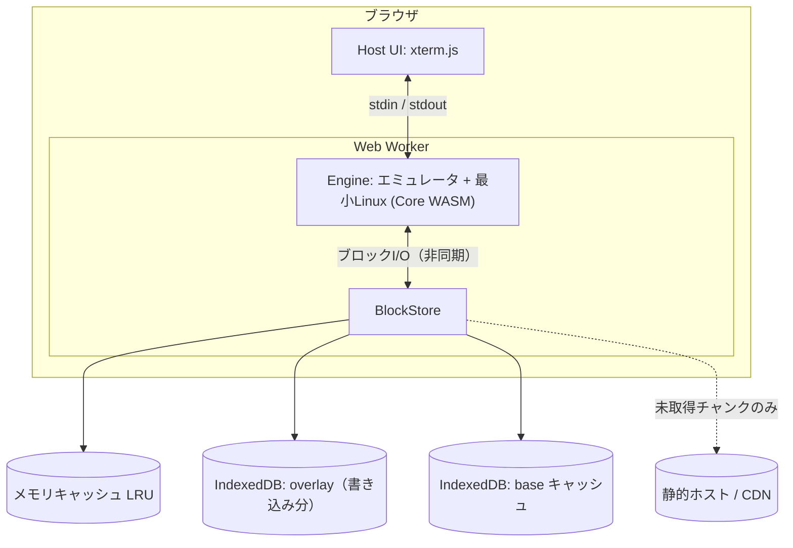

# WasmBox アーキテクチャ

> **Status:** Draft v0.5（2026-10-18）— M1〜M5、ターミナルアプリ（`app/`）、ネットワーク（5.1）を実機（v86 + Alpine、CI の Chromium）で確認済み。残りは、持ち主の判断が要る公開の手続き（9 章・11 章）
> このドキュメントは「いま何が決まっていて、何が未決か」を共有するためのもの。
> 開発者が増えても、AIが入れ替わっても、これを読めば追いつける状態を保つ。

各項目の状態は次の4種で表す。

| 記号 | 意味 |
|---|---|
| ✅ 決定 | 方針として確定。変えるときは決定ログに理由を残す |
| 📝 仮決め | 初期値として置いた。計測して見直す |
| 🔬 要検証 | 実現性や最新状況を確認してから確定する |
| ❓ 未決 | まだ決めていない |

---

## 1. ゴール

ブラウザ内で **Linux（WASM上）を動かし、その中で任意のコマンドを実行できる仮想OS** を作る。

- StackBlitz（WebContainers）のような「Web Node.js専用」ではなく、**汎用的なLinux環境**を目指す。
- Python と Node.js は必要性が極めて高いので **デフォルトで利用可能** にする。
- 永続ストレージは **IndexedDB**。
- メモリ使用量はなるべく小さく。ただし多少の重さは受け入れる。

### 非ゴール（少なくとも初期は）

- 完全な速度（ネイティブ並み）。エミュレーションを使う以上、遅さは前提。
- GUI / デスクトップ環境。まずはターミナルのみ。
- マルチユーザー・サーバー側の実行。すべてクライアント内で完結させる。

---

## 2. 設計方針

1. ✅ **エミュレータ型で本物のLinuxを動かす。** 互換性（bash, apk, Python, Node など）を最優先する。
2. ✅ **ディスクは遅延ストリーミング。** イメージを丸ごとメモリやダウンロードに載せず、触られたチャンクだけ取得する。
3. ✅ **書き込みはメモリ上でライトバック。** IndexedDBへは非同期にまとめて書く。
4. ✅ **Engine と Storage をインターフェースで分離する。** エミュレータ（v86 / container2wasm など）は差し替え可能にする。
5. 📝 **配信は「コアWASM（小さく）＋ストリーミングされるルートFS」の二段構成。** Node / Python は遅延ロード側に置く。

---

## 3. 全体構成



| レイヤー | 役割 |
|---|---|
| **Host** | ターミナルUI、Workerの起動、設定（RAM量など） |
| **Engine** | エミュレータ＋最小Linux。ゲストRAMを確保し、ブロックデバイスI/OをBlockStoreに委譲する |
| **Storage (BlockStore)** | 遅延取得・キャッシュ・Copy-on-Write・ライトバックを担当 |
| **Image** | ビルド時はレイヤー構成（Python / Node など）、配信時はチャンク＋マニフェスト |

---

## 4. Storage 設計

WasmBox の中核。**Engine に依存しない**ように作る。

### 4.1 データモデル

📝 ブロックデバイスを固定サイズの **チャンク** に分割して扱う（初期値 256 KiB。計測して調整する）。

| 領域 | 内容 | 変更可否 |
|---|---|---|
| **base** | 配信されるルートFSイメージ。チャンクごとにハッシュを持つ | 読み取り専用 |
| **overlay** | ゲストが書き込んだチャンクだけを保存（チャンク単位の Copy-on-Write） | 書き込み可 |
| **meta** | マニフェスト、イメージのバージョン、スキーマバージョン | — |

読み取りの優先順位: **overlay → メモリキャッシュ → IndexedDB の base キャッシュ → ネットワーク**

- 書き込みは **常に overlay** へ入る。base は変更しない。
- イメージを更新しても、ハッシュが同じチャンクはキャッシュを再利用できる（📝 内容アドレス方式）。
- overlay を捨てれば「初期状態に戻す」が簡単に実現できる。

### 4.2 IndexedDB と同期/非同期の問題

エミュレータ型では、ゲストのディスクI/Oは割り込み駆動で **もともと非同期** に扱える。
そのため、キャッシュミスやIndexedDBの遅延は「ディスク応答が少し遅れる」だけで済み、同期的にブロックする必要は基本的にない。

ライトバックの目的は次の2つ。

- 小さな書き込みを束ねて **IndexedDBへの書き込み回数を減らす**（性能）
- 書き込みの **順序と原子性** を保つ（整合性）

### 4.3 ライトバックの仕様

- ✅ 書き込みはまずメモリ上の **dirty セット** に入れる。
- 📝 flush のトリガー:
  - 一定時間ごと（数秒。PoC では 1 秒）
  - ✅ **最後の書き込みから一定時間（`flushIdleMs`。PoC では 150 ms）経ったとき**。書き込みが続いている間は延期する（細かい書き込みを束ねる効果は保つ）
  - dirty 量がしきい値を超えたとき
  - `visibilitychange`（hidden）/ `pagehide` 時
  - ゲストからの **flush 要求（fsync / sync 相当）** — このときは **完了を待ってから** ゲストに応答する。※ v86 では届かない（下記）
- ✅ 1回の flush は **1つの IndexedDB トランザクション** にまとめる。成功すれば全部、失敗すれば全部なので、中途半端な状態を残さない。
- 失われうる範囲は「最後の flush 以降の書き込み」だけ。
- ✅ **v86 では、ゲストの fsync（`sync`）は保存を保証しない**（2026-10-15 確認）。
  - 🔬 v86 master の `ide.js` を読んだ限り（要約ツール経由で確認したので、直接 grep して再確認すること）、
    FLUSH CACHE（0xE7 / 0xEA）は status を立てて IRQ を上げるだけで、ディスクのオブジェクトを呼ばない。
    PIO の書き込み（`do_write`）は、`buffer.set` を呼ぶ**前**に IRQ を上げ、`set` の完了コールバックは空。
    したがって、`set` の完了を遅らせて「保存してから応答する」こともできない。
  - ✅ 実測（`tools/persist-smoke.mjs`、CI のヘッドレス Chromium）: ゲストで `echo … > file && sync` した直後（約 1.5 MiB が未保存）にブラウザを閉じると、そのファイルは**失われた**。
    `sync` の直後にリロードした場合も、`pagehide` の flush だけでは間に合わず失われた。
  - 対策: アイドル flush ＋ 定期 flush ＋ `visibilitychange` / `pagehide` の flush。
    実測では、定期 flush を 60 秒に延ばしても、アイドル flush だけで書き込みから約 130 ms で保存済みになり、ブラウザを閉じて開き直しても残った。
    **失われうる範囲は「最後の書き込みから約 150 ms ＋ IndexedDB への保存時間」**。この間にタブを閉じる、またはクラッシュすると失われる。
  - ✅ 失われても壊れない: 保存前に閉じたあとの起動で、ext4 は `recovery complete` と出してジャーナルから回復し、ルートとして起動できた（実測）。
    ユニットテスト（`test/crash-consistency.test.ts`）でも、どの瞬間に落ちても、保存内容は「書き込みを先頭から k 個適用した状態」になることを確認している
    （進行中の 1 回だけは、チャンク境界で途中まで反映されうる）。実装をわざと壊すと、このテストが落ちることも確認済み。
  - 本当に fsync をつなぐには v86 の改造（フォーク）が必要になる。パッチを持たない方針を優先し、今は上の範囲を受け入れている。

### 4.4 遅延ストリーミング

- ✅ マニフェスト（チャンク一覧とハッシュ）を最初に取得し、**チャンクは触られたときに取得する**。
- 取得したチャンクは SHA-256 で検証し、IndexedDB の base キャッシュに保存する。
- 同じチャンクへの同時リクエストは1回にまとめる（in-flight の重複排除）。
- 📝 シーケンシャルアクセスを検出したら先読みする。
- 🔬 配信方式（HTTP Range で1ファイルから取るか、チャンクごとに別ファイルにするか）はホスティング先に依存する。→ 11章。

### 4.5 キャッシュとクォータ

- メモリキャッシュは **バイト予算つきの LRU**（📝 初期値 64 MiB。設定可能）。
- ✅ **容量不足への対応**（`QuotaExceededError`）: overlay の保存が容量不足で断られたら、base キャッシュのチャンクを捨てて、**1 回だけ**保存をやり直す。
  捨てる順番は「このセッションで使っていないもの」→「使ったもの」。数は、必要なぶんの 2 倍（最低 8 チャンク）。overlay は絶対に捨てない。
  捨てても空きができなかった・やり直しも失敗した場合は、エラーを `flush()` の呼び出し元に伝え、書き込みは保存待ちに戻す（容量が空けば、次の flush で保存される）。
  検証: `test/quota.test.ts`（容量を共有する偽の KV を使った単体テスト。実装をわざと壊して、4 種類の変異が検出されることを確認済み）。
- 🔬 **未確認**: 実ブラウザ（Chrome・Firefox・Safari）で、容量不足のときに IndexedDB が返すエラーの `name` と、発生のタイミング。コードは標準の `QuotaExceededError` を前提にしている。
- 📝 `navigator.storage.estimate()` を見て、容量が尽きる**前**に base キャッシュを捨てることは、まだしていない（上の対応は、断られてから動く）。
- 📝 起動時に `navigator.storage.persist()` を要求し、ブラウザによる自動削除を避ける。

### 4.6 複数タブ

- ✅ 同じインスタンスの overlay に **同時に書けるのは1タブだけ**。
- ✅ Web Locks API で排他を取る（`acquireInstanceLock`）。取れなかったタブは「別のタブで開いています」と表示して起動しない（`app/main.ts`）。
  排他そのもの（2 つ目は取れず、解放すれば取れる）は、`poc/selftest.html` で Chromium 156・Firefox 157・WebKit 27.2（Playwright 版。Safari ではない）の実ブラウザで確認した（2026-10-17、CI）。
- 🔬 **未確認**: 2 つのタブを実際に開いたときの、アプリの表示（メッセージの出方）。

### 4.7 インターフェース

✅ 実装済み: `BlockStore` は `src/storage/types.ts`、`Engine` は `src/engine/types.ts`、v86 用の実装は `src/engine/v86-engine.ts`（`V86Engine`）。
`V86Engine` は、シリアルコンソール（ttyS0）をターミナルの入出力に使う。出力は同じ処理の間に届いた分をまとめて渡し、入力は UTF-8 のバイト列を 1 文字 = 1 バイトの文字列にして `serial0_send` へ渡す。
`dispose()` は、ディスクを保存してから v86 を止める（保存に失敗しても v86 は止め、失敗は呼び出し元に伝える）。
`flush()` は、実装（`V86Engine`）にだけ持たせ、`Engine` の契約には入れていない。以下は設計時のスケッチで、実装は上のファイルを正とする。

```ts
/** Engine から見た「ディスク」。ブロックデバイスI/Oの受け口。 */
interface BlockStore {
  readonly size: number;                      // バイト
  read(offset: number, length: number): Promise<Uint8Array>;
  write(offset: number, data: Uint8Array): Promise<void>; // ライトバック（メモリに入れば解決）
  flush(): Promise<void>;                     // IndexedDB への書き込み完了まで待つ
  close(): Promise<void>;
}

/** エミュレータの差し替えポイント。 */
interface Engine {
  boot(opts: {
    disk: BlockStore;
    memoryMiB: number;
    onOutput: (data: Uint8Array) => void;     // ターミナル出力
  }): Promise<void>;
  input(data: Uint8Array): void;              // ターミナル入力
  dispose(): Promise<void>;
}
```

---

## 5. Core（エンジンとカーネル）

- ✅ 1つの **Core WASM** に「エミュレータ＋最小Linuxカーネル＋initramfs」をまとめる。
- 📝 目標サイズは **数十 MB 以下**。Python / Node は含めない。
- 起動後、ルートFSは BlockStore 経由でストリーミングされる。
- ✅ **エンジンは v86**（2026-10-09 仮決め → 2026-10-15 確定。Node.js が動くことを実機で確認した）。
  - 理由: v86 のディスクは `get(offset, len, callback)` / `set(offset, data, callback)` を持つオブジェクトで、`BlockStore` にほぼ 1 対 1 で対応する。
    加えて、v86 master は **`get_and_cache(start, len, callback)`**（`starter.js` が起動前に MBR を読むために呼ぶ）と **`get_from_cache(start, len)`**（`ide.js` のジオメトリ計算が同期で呼ぶ）も要求する（2026-10-09、v86 master のソースで確認）。
  - v86 は、`get` / `set` / `load` を持つオブジェクトを `hda` にそのまま渡せる（v86 master の `starter.js` の `add_file` で確認、2026-10-09）。
    したがって v86 のパッチ（フォーク）は不要のはず。接続は `src/engine/v86-block-device.ts`。
  - 🔬 v86 標準の非同期ディスクは、読んだ・書いたブロックをメモリ上の Map に溜め続け、追い出しの仕組みが見当たらない。WasmBox の LRU＋IndexedDB はそこを補う。
  - ✅ 最大のリスクだった **Node.js は動く**（2026-10-15）。Alpine 3.21 の 32bit（i386）の `nodejs`（v22.23.2）が、v86 上で `node -e "console.log(1 + 1)"` を実行できる。
    CI の実ブラウザで 3 回起動して確認した。Python 3.12.15 も同様。v86 は 32bit x86 のエミュレータで、ゲストの CPU は SSE2 まで（SSE3 なし）。
  - v86 のライセンスは Simplified BSD。
- 🔬 **もう一つの候補: container2wasm**（x86_64 は Bochs、`--to-js` では JIT 付きの QEMU Wasm。デモに python と node のコンテナがある）。
  - ただし **ルートFSはブロックデバイスではなく virtio-9p でマウントされるファイルシステム**。
    `--external-bundle` でも 9p 経由で渡し、OCI イメージを取得する補助ツール（レジストリ側の CORS 設定が必要）を使う。
    採用する場合は、M1 の `BlockStore` は直接つながらず、**ファイル単位の遅延取得と overlay を別途設計**することになる。
  - 古い README には、emscripten 版は起動に 30 秒以上かかりうると書かれている（最新版は未確認）。
  - ライセンスは Apache 2.0。ただし生成物には Bochs などが含まれる。
- Node.js は v86 で動いたため、container2wasm への切り替えは今のところ不要。🔬 予備案として残す。

### 5.1 ネットワーク（M6.1。2026-10-18）

- ✅ **既定はオフ**。利用者がアプリの「ネットワーク」欄で選ぶ（ブラウザの localStorage、キーは `wasmbox:network`）。v86 は起動のときにしか NIC を設定できないので、変えたら保存して再読み込みする。
- ✅ **方式は 2 つ**（`src/engine/network.ts` が `NetworkConfig` を検査して、v86 0.5 の `net_device` に変換する。オプション名は、実物の libv86.js で確認した）:
  - **リレー経由**（`relay_url: "wisp://…"` / `"wisps://…"`。`ws://` / `wss://` の素の WebSocket リレーも設定できるが、動作は確かめていない）。TCP 全般が通る。HTTPS は、ゲストの中で TLS を終える。
  - **ブラウザのみ**（`relay_url: "fetch"`）。ブラウザの `fetch` で、ゲストの HTTP（80 番）だけを中継する。サーバーは要らない。
- ✅ **CI の実ブラウザで確認した**（`tools/net-smoke.mjs`。Chromium 156、v86 0.5、wisp-js 0.5.0。runner 上で WISP サーバーと HTTP の通信先を起動。リレーは同じマシン上）:
  - リレー経由（ne2k と virtio の両方）: DHCP、DNS、runner への HTTP、8 MiB の転送、インターネットの HTTP と HTTPS、`apk update` / `apk add jq` / `apk add npm`、
    Python（`urllib`）と Node.js（`fetch`）の HTTPS、`npm view`、`npm install`（2 パッケージ）が成功した。時間は README の「ネットワーク」の表。
  - ブラウザのみ: `N.external`（ブラウザから見た `localhost:N`）の HTTP は通る。`http://example.com/` は、ブラウザが CORS で止めて、ゲストには `502 Fetch Error` が返る。
    HTTPS は `Connection refused`。つまり **fetch 方式は、HTTP だけの、CORS を許可する相手に限った機能で、パッケージの導入には使えない**。
  - オフ: lo だけが上がる。外への通信は `bad address`。`Node.js` のループバック通信は動く。
- **ゲスト側**（`image/wasmbox-net`。busybox init の `::once:` で起動）:
  - lo は、設定にかかわらず、いつも上げる。
  - v86 は、**ネットワークがオフでも NIC（`eth0`、type=1）を作る**（実測）。つながる先がないので DHCP は失敗する（`udhcpc -t 5 -T 3` なので、待つのは最大で約 15 秒。この値は設定からの計算で、実測はしていない）。そこで、アプリがカーネルのコマンドラインに `wasmbox.net=on` を足したときだけ DHCP を試す。
  - NIC は `/sys/class/net/*/type` が 1（Ethernet）のものだけ。カーネルが作る `sit0` などのトンネルは、NIC として扱わない（`image/README.md`、`test/image-net.test.ts`）。
  - アドレスは v86 の内蔵の DHCP が出す（実測で 192.168.86.100/24、ゲートウェイと DNS は 192.168.86.1）。`/etc/resolv.conf` は `/run/resolv.conf` へのリンクで、ディスクには書かない。
  - ゲストの時計は合っていた（TLS の検証が通った）。
  - カーネルには ne2k のドライバがある（`ne2k-pci … RTL-8029(AS)`）。virtio でも `eth0` ができて通信できた（`dmesg` に、絞り込みの語に当たる行が出ず、ドライバ名は未確認）。
- **安全の考え方**:
  - リレーの URL は、利用者が欄に入れたものだけを使う。URL パラメータの `net` / `relay` / `nic` は、自動テスト用の `?smoke=1` のときだけ効く（リンクで通信先を差し替えられないように。`test/network-setting.test.ts` と、偽の v86 を使った実ブラウザでの確認）。
  - https のページは、暗号化されない `ws://` / `wisp://` に接続できない。設定欄で断り、使えない設定で起動するときは、オフで起動して理由を表示する。
  - リレーの運営者には、通信先（IP とポート）と、HTTP の中身が見える。公開リレーは踏み台になりうる。wisp-js は、ループバックとプライベート IP を既定で拒否する（`options.mjs` の既定値で確認。動作は未検証）。
  - 名前の解決は、ブラウザが DoH で行う（v86 の既定と理解している。CI のリレーのログには、IP アドレスへの接続しか出なかった）。🔬 問い合わせ先のサーバーは未確認。
- 🔬 **未確認**: `wisps://` / `wss://`（TLS 付き）のリレー、https のページからの動作（fetch 方式の mixed content を含む）、インターネット越しのリレー（遅延）、Firefox / WebKit、UDP と ICMP、virtio のドライバ名。
- ❓ **持ち主が決めること**: 公開リレーを運営するか（費用・悪用への対策・利用者の通信が見えること）。運営しないなら、利用者が自分でリレーを用意する前提のまま（README の手順）。

---

## 6. Image（Python / Node のデフォルト同梱）

- ✅ Python と Node.js は **デフォルトで入れる**。
- 📝 ベースは **Alpine（musl）系** でサイズを抑える。
- ビルド時は Dockerfile のようなレイヤー構成（base → Python → Node → …）。配信時はチャンク＋マニフェストにする。
- 遅延ストリーミングにより、**使わないものはダウンロードされない**。「デフォルト同梱」と「初回DLが軽い」を両立させる。
- 📝 初期は **単一のベースイメージ** とする（レイヤーごとにブロックデバイスを分けて overlayfs で重ねる方式は、ゲスト側の設定が増えるので後回し）。
- ⚠️ **Node.js はエミュレータ上のV8になるため遅い。** 速度には過度に期待しない。
  実測（M5、2026-10-15、CI のヘッドレス Chromium、ゲストの `time`、RAM 256 MiB。3 回起動 × 2 回の実行）:
  `node -e "console.log(1)"` が 1.9〜2.6 秒、`python3 -c "print(1)"` が 1.5〜2.5 秒。起動してシェルが使えるまでは 5.1〜6.6 秒。利用者のマシンでは変わる。
  初回（IndexedDB が空）の起動は、シェルが使えるまでに 17 チャンク（約 4.3 MiB）を取得した。2 回目以降はネットワーク取得 0 回。

---

## 7. メモリの考え方

「メモリ問題を完全に解決」はできない。**何が解決し、何が残るか** を明確にしておく。

| 対象 | 状況 | 対策 |
|---|---|---|
| ディスク / ルートFS | ✅ ストリーミングで大幅に削減 | 遅延取得＋LRU＋IndexedDB キャッシュ |
| JS側キャッシュ | ✅ 予算で制御できる | LRU のバイト予算（📝 64 MiB） |
| **ゲストRAM** | ⚠️ **残る** | エミュレータがWASMリニアメモリとして確保する。一度広げると縮まない。wasm32 は 4 GB が上限。→ 初期値は小さく（📝 256 MiB 目安）、設定で変更可能にする。実測: 256 MiB の設定で、起動直後の `free -m` は total 229 / used 5〜6 MiB |
| エミュレータ内部 | 🔬 要計測 | M2 以降でエンジンごとに計測する |

---

## 8. Host

- ✅ ターミナルは **xterm.js 5.5.0**（`app/`）。`vendor/xterm.js`（UMD のグローバル）として読み込む。大きさは 80 桁 × 24 行に固定し、画面の幅に合わせて文字の大きさだけ変える。
  実機で確認済み: 起動、キーボード入力（Playwright の `keyboard.type`）、`insertText` による入力（日本語の文字列。ゲストへ届き、`echo` の結果が表示された）。🔬 未確認: 貼り付け、実際の IME での変換入力、長い行の折り返し、`vim` など画面全体を使うプログラム。
- 📝 エミュレータは、いまは**メインスレッド**で動かしている（`app/main.ts`）。Web Worker 化（UI スレッドを塞がない）は未実施。
  Worker にするときは、`installAutoFlush` の `pagehide` がメインスレッド側で受ける必要がある（`src/storage/lifecycle.ts` の注意書き）。
- ✅ SharedArrayBuffer（COOP/COEP ヘッダ）は、**v86 では要らない**。ヘッダなしの静的配信（`tools/serve.ts`）で、CI の実ブラウザで動いた。
- ⚠️ ゲストから見た `TERM` は `vt102`（実測。busybox init がシリアルコンソールに付ける値）。色付きの表示などには足りないことがある。`xterm` にするには、イメージの terminfo の有無の確認が要る（未対応）。
- ⚠️ 端末の大きさ（80×24）はゲストに伝えていない（ゲストの既定が 80×24 なので、いまは一致している）。

---

## 9. マイルストーン

| # | 内容 | 完了の目安 |
|---|---|---|
| M0 | 設計書、リポジトリ構成、ライセンス選定 | この文書がレビュー済み |
| M1 ✅ | **Storage層**（BlockStore: overlay / CoW、LRU、ライトバック、遅延取得） | 実装済み。ユニットテスト（メモリKV、`fake-indexeddb`）と、実ブラウザ（Chromium）での自己診断が通る |
| M2 ✅ | **Engine PoC**（v86 でシェル起動）＋ BlockStore の接続 | 達成（2026-10-15）。外付け initrd → `switch_root` で ext4 がルートになる直接ルート起動を、CI の実ブラウザで 3 回連続で確認。Node.js が動くことを確認し、エンジンは v86 に確定 |
| M3 ✅ | **永続化の確認** | 達成（2026-10-15）。ファイルを作成 → ブラウザを閉じて開き直し / リロード → 残っている。fsync の挙動も確認: **ゲストの `sync` は保存を保証しない**（4.3）。失われうる範囲を縮めるアイドル flush を追加 |
| M4 ✅ | **Python 同梱** | 達成（2026-10-15）。`python3 -c "print(1)"` が動く（Python 3.12.15） |
| M5 ✅ | **Node.js 同梱＋性能計測** | 達成（2026-10-15）。`node -e "console.log(1)"` が動く（v22.23.2）。起動時間とメモリは 6 章・7 章に記録 |
| M5.1 ✅ | **ターミナルアプリと公開用サイトの組み立て**（`app/`、`tools/build-site.ts`、`.github/workflows/site.yml`） | 達成（2026-10-17）。xterm.js のページから、起動 → 入力 → Node.js 実行 → 「保存済み」表示 → 再読み込みしても残る → 「ディスクを初期化」で消える、までを CI の実ブラウザ（v86 + Alpine）で確認。シェルが使えるまで 7.3 秒（初回）／6.4 秒（再読み込み後）／5.7 秒（初期化後）。サイトは 122 MiB（429 チャンク）。**GitHub Pages への公開は未実施**（持ち主の操作が要る。11 章） |
| M6.1 ✅ | **ネットワーク**（`src/engine/network.ts`、`app/network-setting.ts`、`image/wasmbox-net`、`tools/net-smoke.mjs`） | 達成（2026-10-18）。WISP リレー経由で、DHCP・DNS・HTTPS・`apk add`・Python と Node.js の HTTPS・`npm install` が、CI の実ブラウザで通る（5.1）。既定はオフ。未確認: TLS 付きのリレー、https のページから、Firefox / WebKit |
| M6.2 | （任意）スナップショット（`save_state` / `restore_state`）による高速起動 | — |

---

## 10. 決定ログ

| 日付 | 決定 | 理由 |
|---|---|---|
| 2026-10-09 | 名前は **WasmBox** | — |
| 2026-10-09 | ストレージは **IndexedDB** | ブラウザ内で永続化でき、容量が大きい |
| 2026-10-09 | **エミュレータ型**で本物のLinuxを動かす | 汎用性・互換性を優先。メモリの重さは受け入れる |
| 2026-10-09 | **ライトバック**でIndexedDBへの書き込みを束ねる | 書き込み回数の削減と整合性の確保 |
| 2026-10-09 | **遅延ストリーミング**でディスク側を軽くする（ゲストRAMは別問題として残す） | ダウンロード量とディスク側メモリの削減 |
| 2026-10-09 | **Core（小さな単一WASM）＋ストリーミングFS** の二段構成 | 単一の巨大WASMは遅延ロードと両立しないため |
| 2026-10-09 | Python / Node を **デフォルト同梱** | 必要性が極めて高いため |
| 2026-10-09 | M2 の PoC は **v86** で進める（仮決め。Node.js の可否で最終判断） | ディスクのインターフェースが `BlockStore` と 1 対 1 に対応する。container2wasm はルートFSが 9p でブロック単位ではない |
| 2026-10-09 | v86 へは、`get/set/load` を持つ **アダプタ（`V86BlockDevice`）** を `hda` に渡して接続する | v86 のパッチ（フォーク）が不要なはず（🔬 最新版で要確認） |
| 2026-10-15 | エンジンは **v86 で確定** | Node.js 22 / Python 3.12 が Alpine 3.21（i386）上で動くことを実ブラウザで確認。BlockStore に 1 対 1 で接続でき、v86 のパッチも不要だった |
| 2026-10-15 | 直接ルート起動は **外付け initrd（`/wasmbox-init` → `switch_root`）** | v86-buildroot のカーネルは、内蔵 initramfs の init が `root=` を無視して Buildroot を起動するため。`rdinit=/wasmbox-init` で迂回する |
| 2026-10-15 | **アイドル flush**（`ChunkedBlockStoreOptions.flushIdleMs`。PoC では 150 ms）を追加 | v86 はゲストの sync を伝えず、書き込みの完了も遅らせられないため、タブを閉じたときに失われる範囲を縮める。書き込みが続く間は延期するので、細かい書き込みを束ねる効果は保つ |
| 2026-10-15 | ゲストの sync は保存を保証しないものとして **受け入れる** | v86 の IDE が FLUSH CACHE をディスクに伝えないため（4.3）。v86 を改造しない方針を優先する |
| 2026-10-16 | `Engine` を実装（`V86Engine`）。`flush()` は `Engine` に入れず、実装側に置く | エンジンを替えても、アプリが必要とする契約（boot / input / dispose）は小さく保つ。保存は `dispose()` が必ず行う |
| 2026-10-16 | 端末は **xterm.js 5.5.0 を UMD のグローバルとして vendor**（v86 と同じ作法）。80×24 固定 | package.json / ロックファイルを増やさず、公開する成果物のバージョンを固定できる。ゲストへ端末の大きさを伝えない（伝える手段がシリアルにはない）ので、ゲストの既定（80×24）に合わせる |
| 2026-10-16 | 容量不足（`QuotaExceededError`）のとき、**base キャッシュを捨てて 1 回だけやり直す**。overlay は捨てない | overlay は利用者のデータで、base はサーバーから取り直せる。やり直しても失敗するなら、エラーを呼び出し元に伝える（4.5） |
| 2026-10-17 | サイトの公開（GitHub Pages への deploy）は、**手動実行（`workflow_dispatch`）かつ `main` のときだけ** | Pages の有効化、ライセンス、GPL の部品のソース提供は、持ち主が決めること（`THIRD_PARTY_NOTICES.md`）。ビルドと実ブラウザでの確認は、毎回の push で行う |
| 2026-10-17 | 自己診断（`poc/selftest.html`）を、CI で Chromium・Firefox・WebKit（Playwright 版）に対して実行する | クロスブラウザの確認を、手作業から外す。初回は 3 つとも 22 件成功。Firefox / WebKit の失敗は、当面は警告にとどめる |
| 2026-10-18 | ネットワークは**既定でオフ**。利用者が欄で選び、変更は保存して再読み込みで反映する | v86 は起動のときにしか NIC を設定できない。信頼できないコードを動かすときの安全側（5.1） |
| 2026-10-18 | 実用の方式は **WISP リレー**。fetch 方式は、HTTP の 80 番だけの限定的な機能として残す | 実測: fetch 方式は、CORS を許可しない相手に届かず（502）、HTTPS は通らない。WISP なら、`apk` / `pip` / `npm` が通った |
| 2026-10-18 | **既定のリレーは置かない**。URL は利用者が入力する。URL パラメータでの指定は `?smoke=1` のときだけ | 公開リレーの運営・費用・悪用への対策は、持ち主の判断。リンクで通信先を差し替えられないようにする |
| 2026-10-18 | ネットワークの有効 / 無効は、カーネルのコマンドライン（`wasmbox.net=on`）でゲストに伝える | v86 はオフでも NIC を作る（実測）ので、ゲストだけでは区別できず、オフのときも、失敗する DHCP を試すことになる（最大で約 15 秒の計算。実測はしていない） |
| 2026-10-18 | NIC は **ne2k**（v86 の既定）。virtio も動くが、設定欄には出さない | どちらも通り、速度の差は 1 回ずつの測定では誤差の範囲（8 MiB が 4.4 秒 / 5.0 秒）。選ぶ理由がない |
| 2026-10-18 | CI の net-smoke は、**外部に依存しないものは失敗、インターネットに依存するものは警告**にする | オフ・DHCP・runner への HTTP・8 MiB の転送が通るなら、ゲストのネットワークは動いている。DNS・HTTPS・Alpine の CDN・npm のレジストリは、外の事情で落ちうる |
| 2026-10-18 | イメージに `wasmbox-net` と inittab の 1 行を足した | イメージが変わると manifest が変わり、以前の overlay は使えない（`ManifestMismatchError`。ストア層の仕様）。公開前なので、影響する利用者はいない |
| 2026-10-19 | WasmBox 自身のライセンスは **GPL-3.0-or-later**（GPL-3.0 の「以降のバージョンも許す」形）。著作権表示は入れない | 持ち主の決定（最初は「GPL-3.0」とだけ指示。同日、or-later と、著作権表示なしを決めた）。「以降のバージョンも」という意思は、README の標準の許諾文で示す |
| 2026-10-19 | **GitHub Pages での公開は一時的で、ソースコードを見せるだけ**。アプリ本体は Pages に載せない。CI は Pages 用の成果物を、`main` での手動実行のときしか作らない | 持ち主の方針。GPL の部品（カーネルなど）の再配布と、ソース提供の問題を、アプリを公開するときまで先送りできる。毎回の CI で 122 MiB を作らなくてもよくなる |

---

## 11. 未決事項・リスク

- ✅ **エンジン選定**: v86 に確定（5 章）。container2wasm は 🔬 予備案。
- ❓ **イメージのホスティング**:
  - ✅ チャンクごとに別ファイル（256 KiB）にする方式を採用。サイト全体は 122 MiB（429 チャンク）で、1 ファイルが 100 MB を超えない。COOP/COEP ヘッダは要らない（8 章）。
  - 🔬 GitHub Pages の制限（サイト 1 GB、1 ファイル 100 MB）は、公式の情報を私が読んだものではなく、理解にもとづく。**アプリ**の Pages 上での動作は未確認（まだ公開していない）。
  - GitHub Pages は、持ち主がすでに有効にしている。いま公開されているのは、README を文書として表示するページ（`https://maru-m4ru-maru.github.io/WasmBox/`。2026-10-18 に確認）。
    デプロイの記録の `ref` が開発ブランチ（`claude/complete-wasmbox`）なので、公開元はこのブランチと見られる（設定そのものは API が使えず、読めていない）。
    つまり、このブランチの README の変更は、そのまま公開される。`site.yml` の `deploy` は、公開元が「GitHub Actions」であることを前提にするので、アプリの公開には、持ち主が Pages の設定を変える必要がある（🔬 公式の手順は未確認）。
  - 外部の静的ホスト / CDN にするかは、持ち主の判断。
- ✅ **イメージのビルドパイプライン**: `image/build.sh`（Dockerfile で Alpine i386 + nodejs + python3 → `mke2fs` で ext4 → `tools/chunk-image.ts` でチャンク＋マニフェスト）。
- ✅ **ネットワーク**: ゲストから外へ出る手段は、WISP リレーで実現できた（5.1）。
  - ❓ 公開リレーを運営するか（持ち主の判断。費用・悪用への対策・利用者の通信が見えること）。
  - 🔬 TLS 付きのリレー、https のページからの動作、インターネット越しの遅延、Firefox / WebKit は未確認。
- ✅ **WasmBox 自体のライセンス**: GPL-3.0 の「以降のバージョンも許す」形（GPL-3.0-or-later。持ち主の決定、2026-10-19。`LICENSE`、`package.json`）。著作権表示は入れない（持ち主の決定）。
- ❓ **配布物の再配布の条件**（v86、SeaBIOS、Linux カーネル、busybox など GPL を含む）: 下書きと確認項目は [THIRD_PARTY_NOTICES.md](./THIRD_PARTY_NOTICES.md)。
  Pages にアプリを載せない方針（2026-10-19）の間は、配布が起きない。アプリを公開するときに、GPL の部品のソース提供の方法を決めて、確認する。
- ⚠️ **Node.js の実用速度**: 起動に約 2 秒（6 章）。重い処理は遅い。許容できない用途が出たら、ホストのJSエンジンを使う案など別の手段を検討する。
- ⚠️ **クロスブラウザ**: `poc/selftest.html`（Storage 層とアダプタ。v86 なし）は、Chromium 156・Firefox 157・WebKit 27.2（Playwright 版。**Safari そのものではない**）の CI で 22 件すべて成功（2026-10-17）。
  🔬 **未確認**: v86 + Alpine の起動（Chromium のみ確認）、実際の Safari、モバイル、Windows / macOS、IndexedDB の容量上限や `persist()` の挙動（ブラウザごとに違う）、容量不足のときのエラー。
